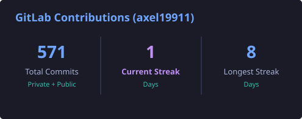

### Hi there 👋 I'm Alex, a Backend & Systems Software Engineer

* 🔭 **Primary Stack:** PHP (Laravel), Go.
* ⚡ **Systems & Low-Level:** C, C++, Microcontrollers (STM32, ESP32).
* 🛠️ **Current Focus:** Building high-load e-commerce backends, automated data pipelines, and bots.

---

### 💻 Tech Stack & Tools

| Category | Technologies / Tools |
| :--- | :--- |
| **Languages** | PHP, Go, C, C++ |
| **Frameworks & Core** | Laravel, Vue.js |
| **Infrastructure** | Docker, Linux (Ubuntu Server), DigitalOcean, GCP |
| **Hardware & IoT** | STM32, ESP32 |

---

### 💼 Commercial Experience & Key Solutions

*Most of my production work resides in private commercial repositories under NDA. Key architectures and systems I've built include:*

* **High-Load E-commerce Platforms** — End-to-end backend development on Laravel, custom admin panels (Encore-Admin, Filament), queue management via Redis/Horizon, and database optimization.
* **Automated Data & Supplier Pipelines** — Scalable parsers and import engines (XML, CSV, Google Sheets, REST APIs) with dynamic pricing rules and automated catalog synchronization.
* **AI-Driven Content & Mapping** — Integration of LLM APIs (Google AI, Openrouter, Requesty and other APIs) for automated product attribute mapping and bulk SEO copywriting.
* **Go Microservices & Bots** — Concurrent backend services, webhook integrations, and API-driven bots written in Go.
* **Databases & Caching** — Relational database management with MySQL, PostgreSQL, and data handling through Redis, query optimization, and schema design.
* **Embedded Systems & Firmware** — Low-level C/C++ development for microcontrollers (STM32, ESP32), real-time task management using FreeRTOS, hardware peripherals (UART, I2C, SPI, CAN, USB, ADC, Timers, DMA, Interrupts), and memory pool management.
---

  

  

